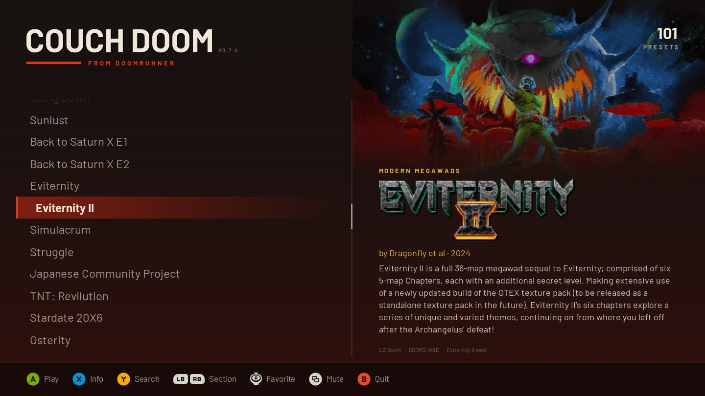
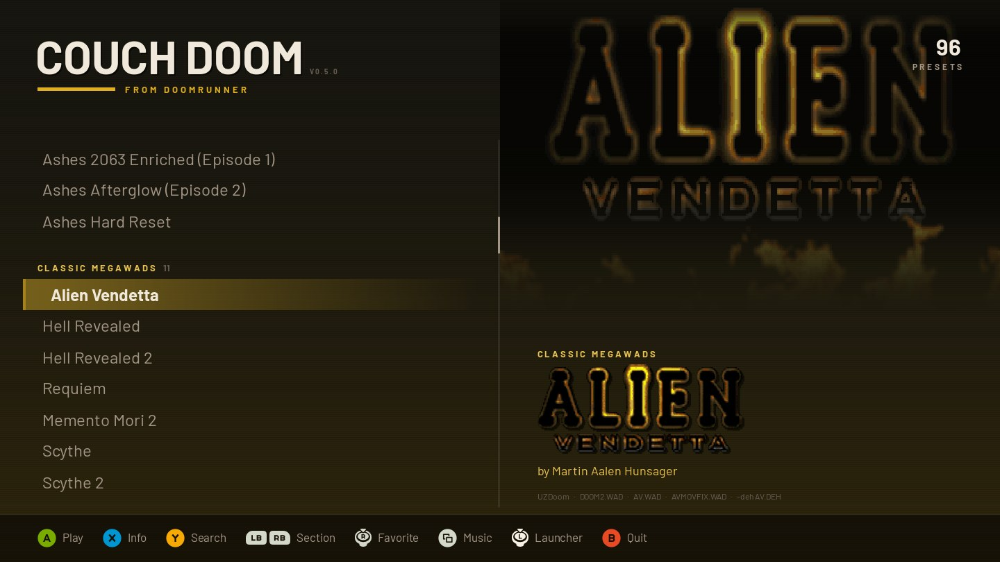
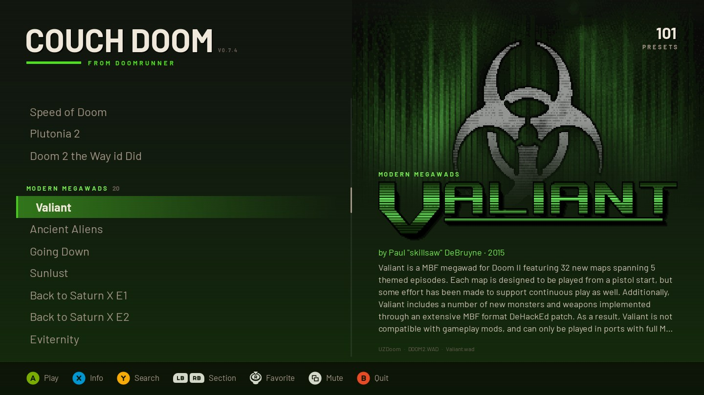
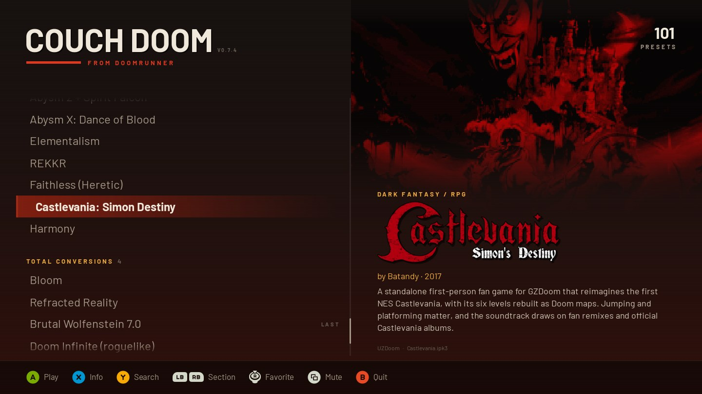
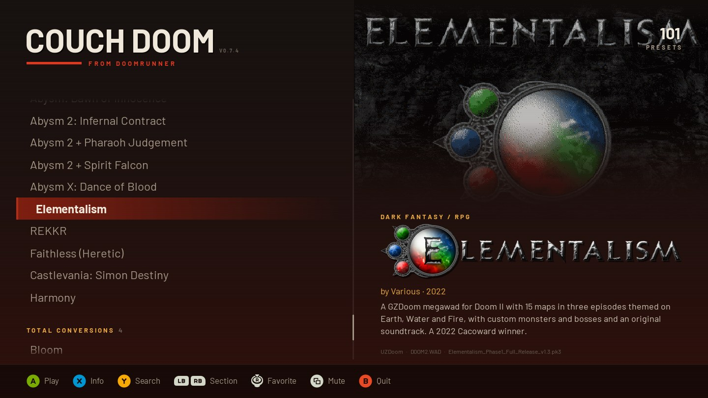
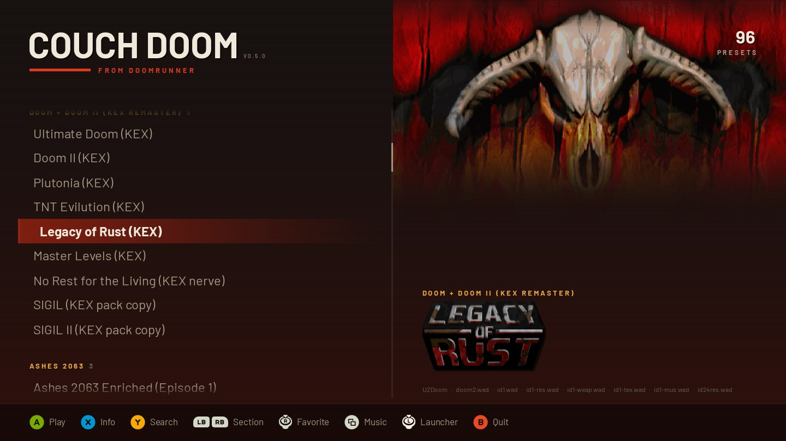
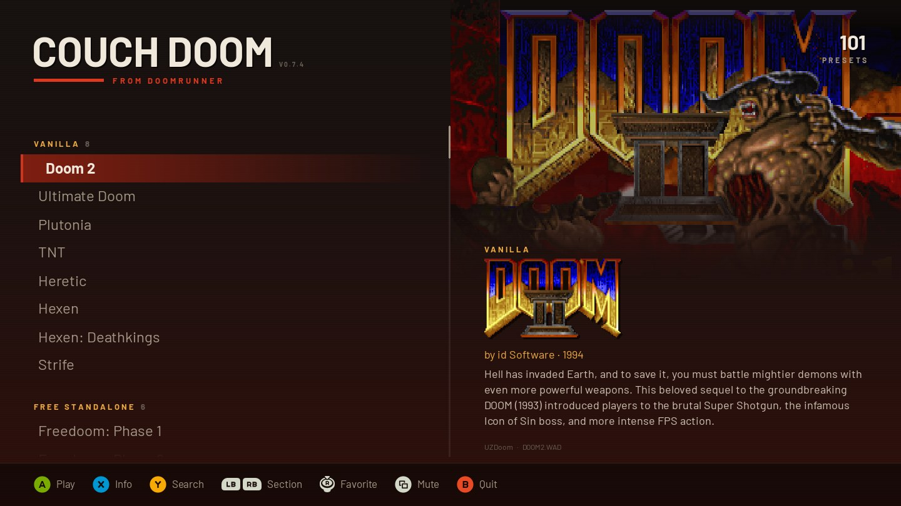
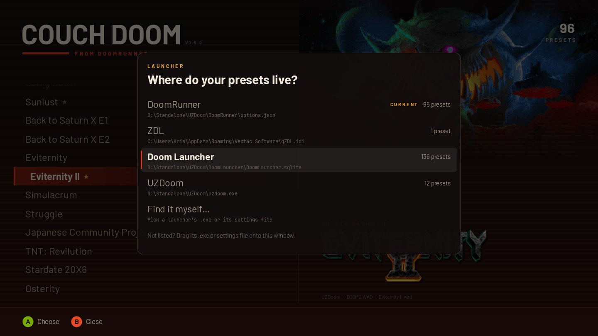

# CouchDoom

Made by [KrisEnigma](https://github.com/KrisEnigma).

CouchDoom puts the Doom games and mods you already have on a big, controller-friendly screen. It reads setups from DoomRunner, ZDL and Doom Launcher, or finds games through GZDoom, UZDoom and VKDoom. Choose a game to launch it with the same engine and files your usual setup uses.

Use it from the couch, at your desk or on a Steam Deck. CouchDoom reads your launcher settings but never changes them; keep setting up games in your usual launcher.

  
  

  
  

  
  

## What it works with

| Your setup | What CouchDoom shows |
| --- | --- |
| [DoomRunner](https://github.com/Youda008/DoomRunner) | Your saved presets and launch options |
| [ZDL / qZDL](https://github.com/lcferrum/qzdl) | Your current setup and saved .zdl setups |
| [Doom Launcher](https://github.com/nstlaurent/DoomLauncher) | Games with saved settings and profiles |
| [Doom Launcher 667](https://github.com/Realm667/DoomLauncher667) | Games grouped by collection |
| GZDoom, UZDoom or VKDoom | The games those ports can already find |

If you use a launcher, CouchDoom uses its engine choices and settings. Without one, it lists the IWADs found by a supported source port. You can also browse for a launcher, port or settings file yourself.

### Finding your setup

CouchDoom checks common install locations and follows Windows shortcuts, including portable installs. If it finds one setup, it opens it. If it finds several, choose one; CouchDoom remembers your choice. Switch later with **L3** (click the left stick) or **F4**.

If nothing is found, choose **Find it myself…** and browse with a controller: D-pad or stick to move, **A** to open or choose, **B** to go up, **X** to show all files, **LB/RB** to switch drives or roots, and **LT/RT** to page through the list. You can also drag a file onto the window.

## Install

Download a build from the [latest release](https://github.com/KrisEnigma/couch-doom/releases/latest). You don't need Python. CouchDoom isn't code-signed, so your system may ask you to confirm the first launch.

- **Windows:** Download `windows-x64.zip`, extract it, and run `CouchDoom.exe`. If SmartScreen appears, choose **More info → Run anyway**.
- **macOS:** Download the disk image for your Mac:
  - Apple Silicon: `macos-arm64.dmg`
  - Intel: `macos-x64.dmg` (macOS 10.15 or later)

  Open the disk image and drag `CouchDoom.app` to Applications. The app isn't code-signed, so macOS may block its first launch. If it does, choose **System Settings → Privacy & Security → Open Anyway**. Matching ZIP downloads are available as a fallback.
- **Linux:** Download `linux-x64.tar.gz` for most PCs or `linux-arm64.tar.gz` for ARM boards, extract it, and run `./CouchDoom`. Requires glibc 2.28 or newer.
- **Steam Deck:** In Desktop Mode, extract the Linux x64 archive. In Steam, choose **Add a Non-Steam Game** and select CouchDoom, then launch it from Game Mode. GZDoom and DoomRunner installed from Discover are detected automatically.

### Run from source

For development or to run from a checkout, install Python 3.11 or later:

    git clone https://github.com/KrisEnigma/couch-doom.git
    cd couch-doom
    python3 -m venv .venv
    .venv/bin/pip install -r requirements.txt
    PYTHONPATH=src .venv/bin/python -m couch_doom

MIDI playback support from source also needs tinysoundfont. On macOS, if GZDoom was downloaded but never opened, launch it once from Finder so its first-run prompt doesn't appear behind CouchDoom.

## Controls

| Controller | Keyboard | Action |
| --- | --- | --- |
| D-pad / left stick | Arrows | Move |
| A / Start | Enter | Play |
| X | Tab | Readme and ENDOOM info |
| Y | / or type | Search |
| R3 | F3 | Add or remove a favorite |
| Back / View | F2 | Toggle title music |
| L3 | F4 | Choose a launcher |
| LB / RB | Left / Right | Change section |
| LT / RT | PgUp / PgDn | Jump through the list |
| B | Esc | Clear search, or press twice to quit |

Mouse and keyboard prompts are available too. CouchDoom hides while a game runs and returns when it closes. Favorites have their own section at the top.

## What you'll see and hear

- Each game can show its title screen, logo, title music and readme. ENDOOM appears when the game includes one.
- Mods without their own title art can use their loading screen instead.
- Menu sounds come from a Doom-family IWAD when available, or from bundled Freedoom sounds when they aren't.
- WAD, PK3 and IPK3 files are supported; PK7 isn't.

## A few extras

- CouchDoom checks GitHub once after startup for updates. Packaged builds can install an update; source builds use the release page. Turn the check off with the `update_check` setting in `last_played.json` or by setting `COUCHDOOM_NO_UPDATE_CHECK`.
- Favorites and preferences are saved locally. The troubleshooting log can include file paths and launch output, so review it before sharing.
- From source, `--windowed` opens a window, `--dry-run` prints launch commands, `--options` opens a settings file or supported port, and `--soundfont` selects MIDI music playback.

## Credits and license

CouchDoom is MIT licensed; see [LICENSE](LICENSE).

- **Fonts:** [Barlow](https://github.com/jpt/barlow) and [JetBrains Mono](https://github.com/JetBrains/JetBrainsMono), both SIL Open Font License.
- **Controller icons:** [Kenney's Input Prompts](https://kenney.nl/assets/input-prompts), CC0.
- **Menu sounds:** [Freedoom](https://github.com/freedoom/freedoom), modified BSD license. See the bundled [notice](src/couch_doom/assets/freedoom/THIRD-PARTY-NOTICES.txt).
- **MIDI SoundFont:** [UZDoom](https://github.com/UZDoom/UZDoom).
