# CouchDoom

Made by [KrisEnigma](https://github.com/KrisEnigma).

CouchDoom puts the Doom games and mods you already have on a big, controller-friendly screen. It reads setups from DoomRunner, ZDL and Doom Launcher, or finds games through GZDoom, UZDoom and VKDoom. Choose a game to launch it with the same engine and files your usual setup uses.

Use it from the couch, at your desk or on a Steam Deck. CouchDoom reads your launcher settings but never changes them; keep setting up games in your usual launcher.

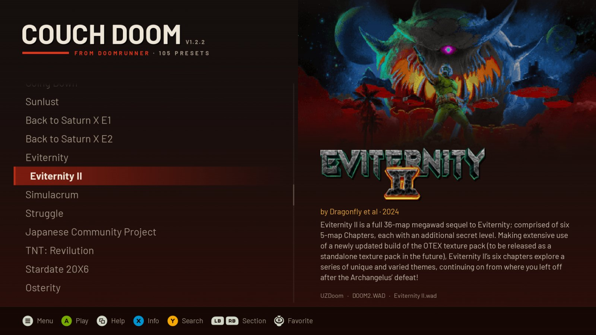

  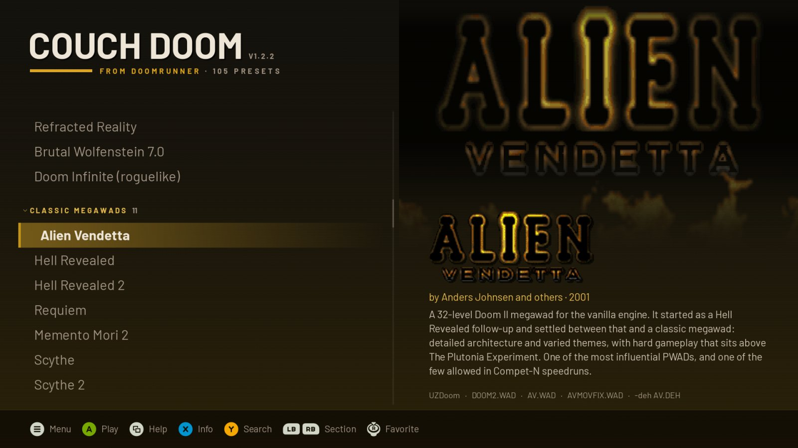
  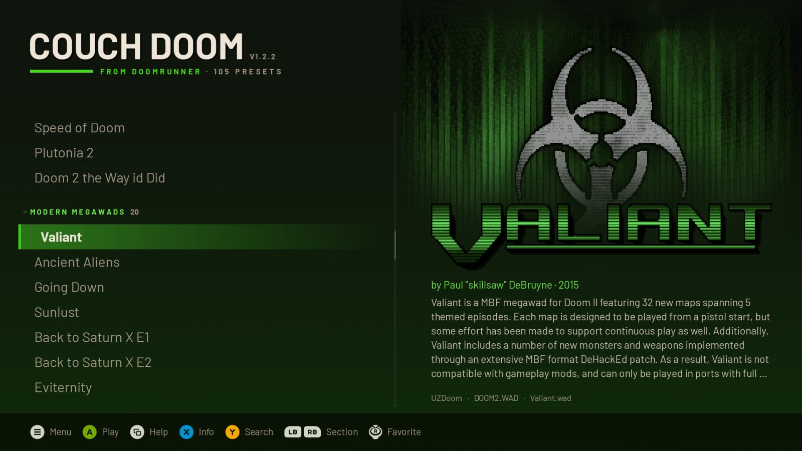

  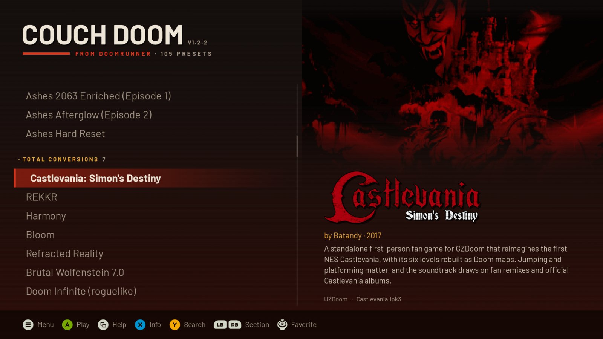
  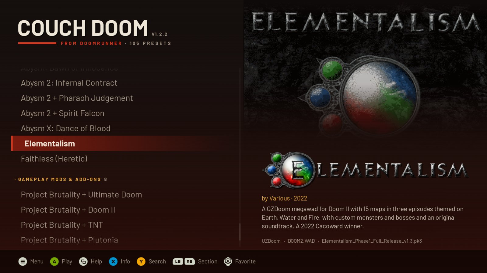

  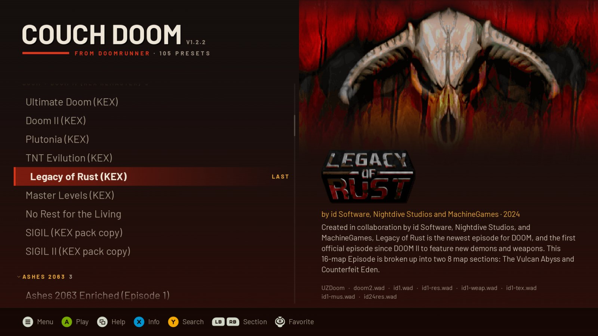
  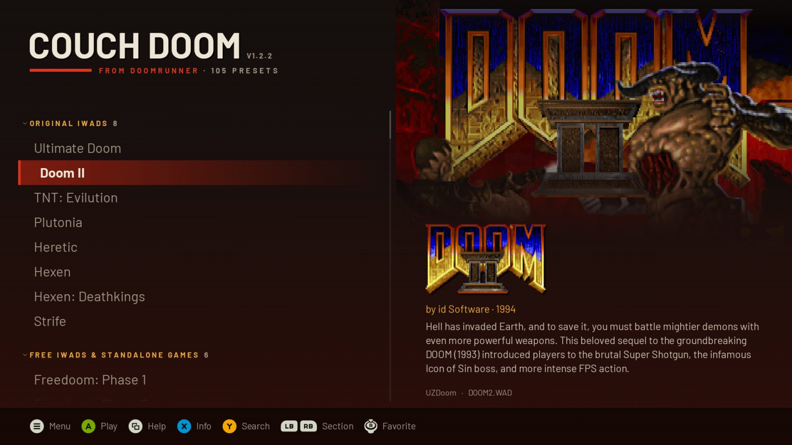

  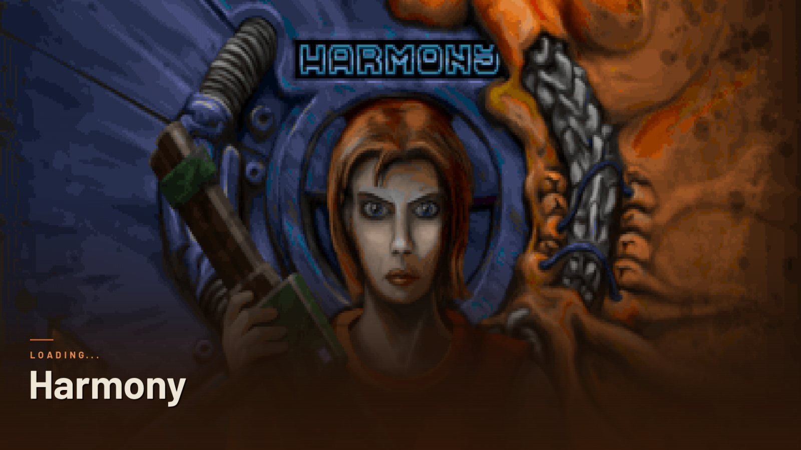
  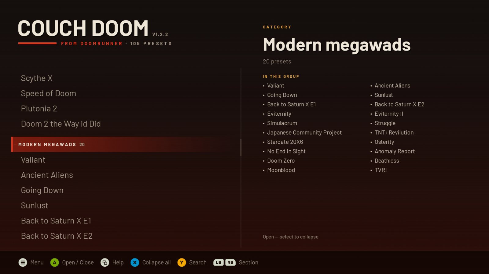

## What it works with

| Your setup | What CouchDoom shows |
| --- | --- |
| [DoomRunner](https://github.com/Youda008/DoomRunner) | Your saved presets and launch options |
| [ZDL / qZDL](https://github.com/lcferrum/qzdl) | Your current setup and saved .zdl setups |
| [Doom Launcher](https://github.com/nstlaurent/DoomLauncher) | Games with saved settings and profiles |
| [Doom Launcher 667](https://github.com/Realm667/DoomLauncher667) | Games grouped by collection |
| GZDoom, UZDoom or VKDoom | The games those ports can already find |

If you use a launcher, CouchDoom uses its engine choices and settings. Without one, it lists the IWADs found by a supported source port. You can also browse for a launcher, port or settings file yourself.

### Finding your setup

CouchDoom checks common install locations and follows Windows shortcuts, including portable installs. If it finds one setup, it opens it. If it finds several, choose one; CouchDoom remembers your choice. Switch later from the menu.

If nothing is found, choose **Find it myself…** and browse with a controller: D-pad or stick to move, **A** to open or choose, **B** to go up, and **X** to show all files. Select **Parent folder** to go up one folder; at a drive root, select **Drives & home** for the separate location list. On the keyboard, **Escape** closes the browser and Page Up/Down move by one visible page without wrapping. In an installed copy the browser starts in CouchDoom's own folder, so a launcher kept beside it is right there. You can also drag a file onto the window.

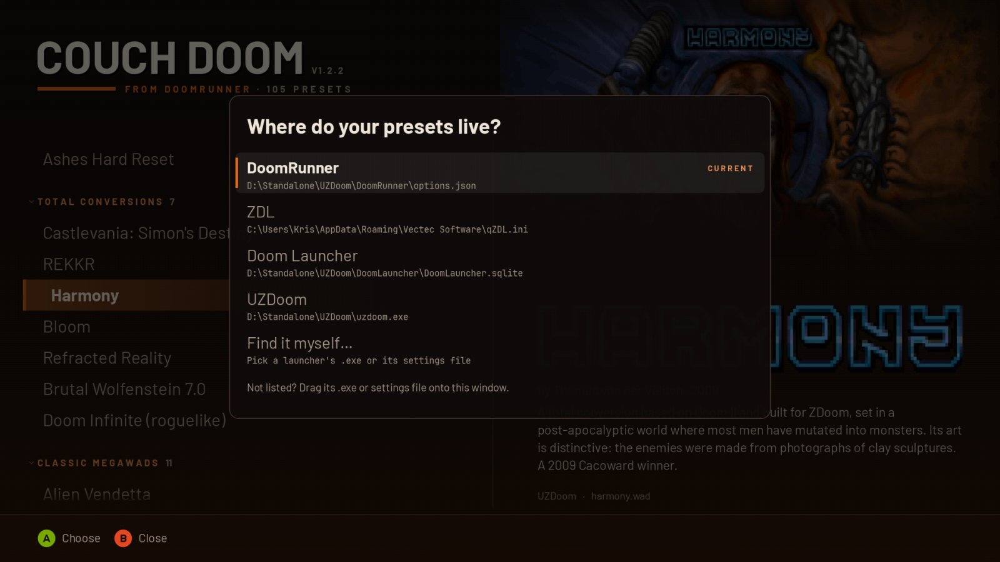

## Install

Download a build from the [latest release](https://github.com/KrisEnigma/couch-doom/releases/latest). You don't need Python. CouchDoom isn't code-signed, so your system may ask you to confirm the first launch.

- **Windows:** Download `windows-x64.zip`, extract it, and run `CouchDoom.exe`. If SmartScreen appears, choose **More info → Run anyway**.
- **macOS:** Download the disk image for your Mac:
  - Apple Silicon: `macos-arm64.dmg`
  - Intel: `macos-x64.dmg` (macOS 10.15 or later)

  Open the disk image and drag `CouchDoom.app` to Applications. The app isn't code-signed, so macOS may block its first launch. If it does, choose **System Settings → Privacy & Security → Open Anyway**. Matching ZIP downloads are available as a fallback.
- **Linux:** Download `linux-x64.tar.gz` for most PCs or `linux-arm64.tar.gz` for ARM boards, extract it, and run `./CouchDoom`. Requires glibc 2.28 or newer.
- **Steam Deck:** In Desktop Mode, extract the Linux x64 archive. In Steam, choose **Add a Non-Steam Game** and select CouchDoom, then launch it from Game Mode. GZDoom and DoomRunner installed from Discover are detected automatically.

### Run from source

For development or to run from a checkout, install Python 3.11 or later:

    git clone https://github.com/KrisEnigma/couch-doom.git
    cd couch-doom
    python3 -m venv .venv
    .venv/bin/pip install -r requirements.txt
    PYTHONPATH=src .venv/bin/python -m couch_doom

MIDI playback support from source also needs tinysoundfont, installed with `python packaging/install_tinysoundfont.py` (a plain `pip install` still has a bug that crashes the Intel Mac build on quit). On macOS, if GZDoom was downloaded but never opened, launch it once from Finder so its first-run prompt doesn't appear behind CouchDoom.

## Controls

| Controller | Keyboard | Action |
| --- | --- | --- |
| D-pad / left stick up or down | Up / Down | Move through games |
| D-pad / stick left or right | Left / Right | Left goes to the current group heading, then the previous group; Right goes to the next group |
| A | Enter | Play or open / close a section heading |
| Back / View | F1 | Quick help |
| Start | Esc | Open the menu |
| — | F5 | Help & feedback |
| X | Tab | Readme and ENDOOM info; on a group heading, expand or collapse every group |
| Y | / or type | Search |
| R3 | F3 | Add or remove a favorite |
| LB / RB | — | Jump between sections |
| LT / RT | PgUp / PgDn | Jump through the list |
| — | Home / End | Jump to the top / bottom of the list or file browser |
| B | — | Back from an open panel |

Escape or Start opens the menu. From there you can return to the list, refresh launcher data, choose a launcher, toggle title music or menu sounds with Left/Right, cycle Colors and Language, turn the optional Recently Played group on or off, open Help, or quit.

Language follows the OS on first run when CouchDoom supports it (English, Spanish, Brazilian Portuguese, French, German). Change it anytime from the menu. Colors can follow each game's art or lock one look for the whole app.

  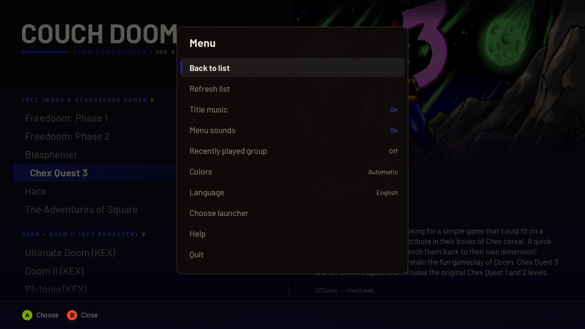
  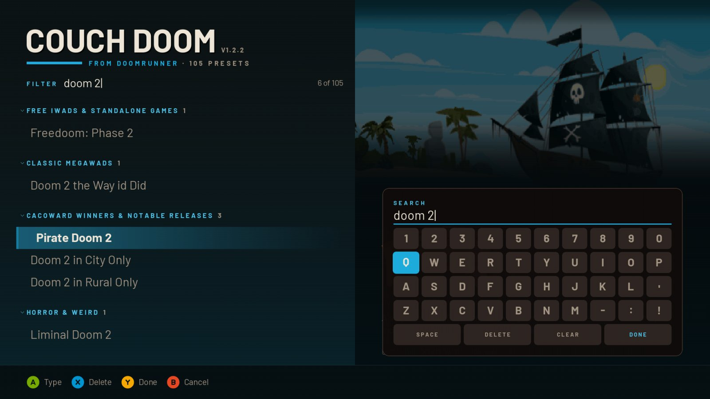

Fold a group heading when you want that section out of the way. Search still finds games inside collapsed groups. Favorites stay near the top.

B closes an open panel and does nothing on the main selector. Mouse and keyboard prompts are available too. CouchDoom hides while a game runs and returns when it closes.

## What you'll see and hear

- Each game can show its title screen, logo, title music and readme. ENDOOM appears when the game includes one.
- Mods without their own title art can use their loading screen instead.
- Menu sounds come from a Doom-family IWAD when available, or from bundled Freedoom sounds when they aren't.
- WAD, PK3 and IPK3 files are supported; PK7 isn't.

  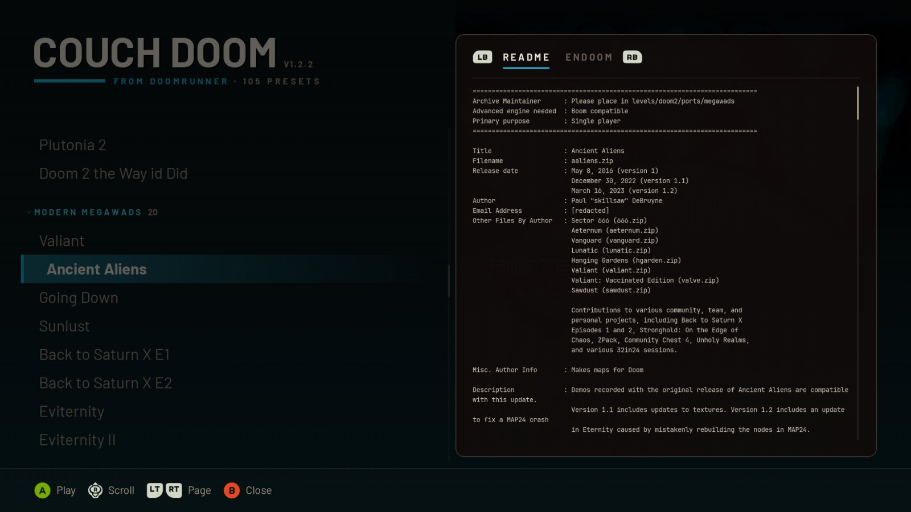
  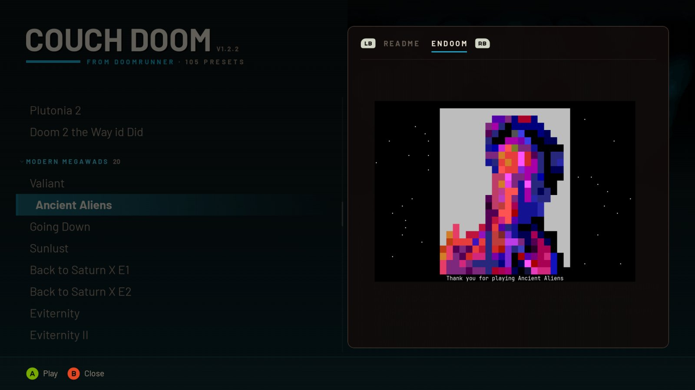

## A few extras

- CouchDoom checks GitHub once after startup for updates. Packaged builds can install an update; source builds use the release page. Turn the check off with the `update_check` setting in `last_played.json` or by setting `COUCHDOOM_NO_UPDATE_CHECK`. Leftover folders from an interrupted update are cleaned up on the next launch.
- Favorites, language, colors, Recently Played, and other preferences are saved locally. The troubleshooting log can include file paths and launch output, so review it before sharing.
- From source, `--windowed` opens a window, `--dry-run` prints launch commands, `--options` opens a settings file or supported port, and `--soundfont` selects MIDI music playback.

## Credits and license

CouchDoom is MIT licensed; see [LICENSE](LICENSE).

- **Fonts:** [Barlow](https://github.com/jpt/barlow) and [JetBrains Mono](https://github.com/JetBrains/JetBrainsMono), both SIL Open Font License.
- **Controller icons:** [Kenney's Input Prompts](https://kenney.nl/assets/input-prompts), CC0.
- **Menu sounds:** [Freedoom](https://github.com/freedoom/freedoom), modified BSD license. See the bundled [notice](src/couch_doom/assets/freedoom/THIRD-PARTY-NOTICES.txt).
- **MIDI SoundFont:** [UZDoom](https://github.com/UZDoom/UZDoom).
